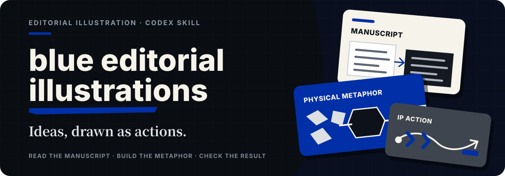
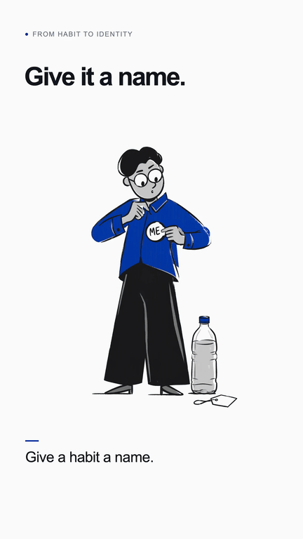
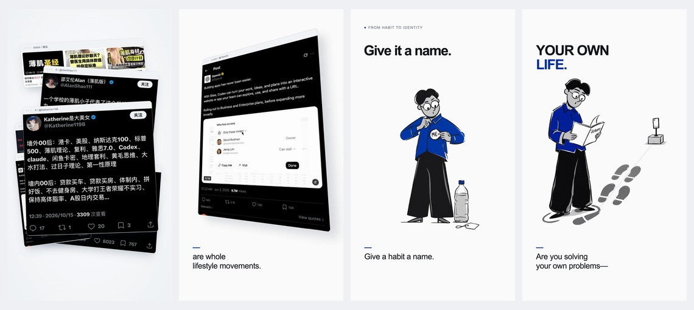
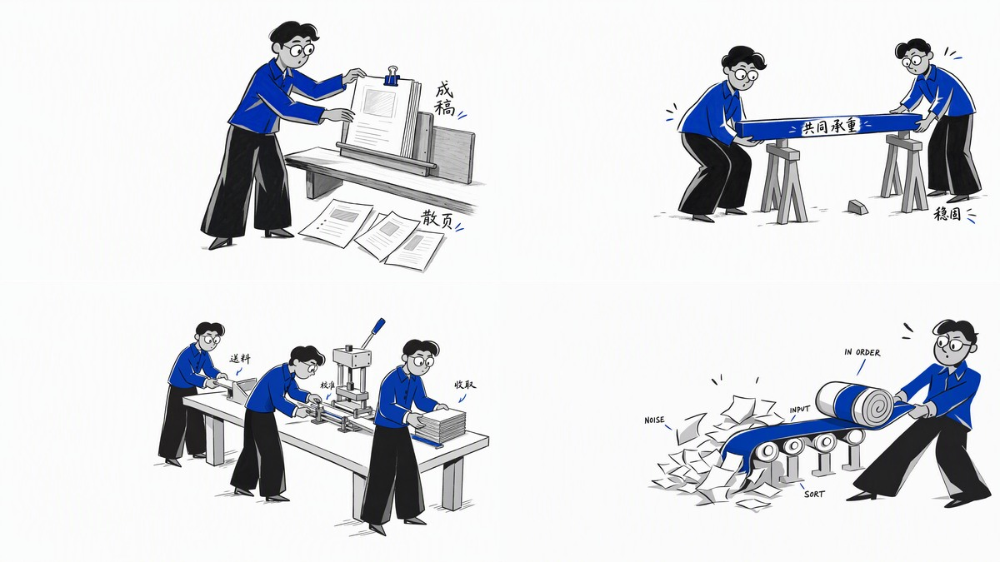
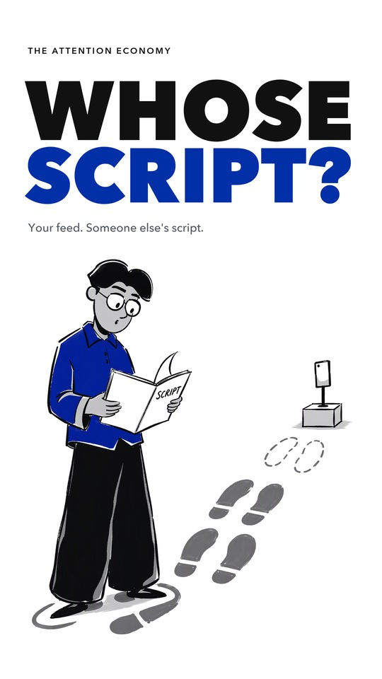

<p align="center">
  
</p>

<p align="center">
  <a href="https://github.com/Lee-study154/blue-editorial-illustrations/releases/tag/showcase-attention-economy-v1">
    
  </a>
</p>

<p align="center">
  <a href="https://github.com/Lee-study154/blue-editorial-illustrations/releases/tag/showcase-attention-economy-v1"><b>Watch the full film (4K60 / 1080p60)</b></a>
  &nbsp;·&nbsp; <a href="./blue-editorial-illustrations/SKILL.md">The skill</a>
  &nbsp;·&nbsp; <a href="./blue-editorial-illustrations/assets/examples/">The illustrations</a>
</p>

**BLUE EDITORIAL ILLUSTRATIONS** turns a manuscript into original visual metaphors: a recurring glasses-wearing
character sorts, repairs, carries and connects things to make an abstract idea visible. White space, black ink,
cool gray and a single Klein blue hold the series together. This repository contains the reusable illustration
skill, its character reference, prompts and ten reference images.

**The Attention Economy** is a 43.2-second film showing the illustrations in use, alongside real social pages,
motion and English narration. The preview above is an eight-second, silent excerpt in the original 9:16 format;
the complete film includes voice, music and sound effects. Illustration generation belongs to this skill;
animation, editing and audio were produced in a [separate video workflow](./assets/showcase/attention-economy/README.md).

<p align="center">
  <a href="https://github.com/Lee-study154/blue-editorial-illustrations/releases/tag/showcase-attention-economy-v1">
    
  </a>
</p>

## How it works

- **One idea becomes one action.** Identify the claim or change in a passage, then find a physical verb for it:
  sort, join, support, measure or repair. The character changes the situation instead of standing beside a label.
- **The character stays recognizable.** A fixed identity reference and visual rules keep the glasses, eyes,
  silhouette, clothing and palette consistent across single-person, paired and group scenes.
- **Words belong to objects.** Short labels sit near the action, material or result they describe. Chinese is
  the default; English labels are available when requested. HTML headings and body text remain editable text.
- **Each image is reviewed on its own.** Check the metaphor, anatomy, ground contact, character identity and
  exact lettering. Local edits preserve the rest of the composition. Default output is a 2048×1152 PNG.

<details>
<summary>The reference pack: eight Chinese examples and two English examples</summary>

<p>
  
</p>

These images calibrate character, composition and lettering. New manuscripts receive new metaphors.
Browse the [complete reference pack](./blue-editorial-illustrations/references/reference-pack.md),
[Chinese prompts](./blue-editorial-illustrations/prompts/final-reference/) and
[English prompts](./blue-editorial-illustrations/prompts/english-reference/).

</details>

## Use it

**The skill.** Download the [v1.0.0 installation ZIP](https://github.com/Lee-study154/blue-editorial-illustrations/releases/tag/v1.0.0),
or copy the repository's `blue-editorial-illustrations/` directory into your agent's skills folder:

```bash
git clone https://github.com/Lee-study154/blue-editorial-illustrations.git
cd blue-editorial-illustrations
mkdir -p "${CODEX_HOME:-$HOME/.codex}/skills"
cp -R ./blue-editorial-illustrations "${CODEX_HOME:-$HOME/.codex}/skills/"
```

Start a new conversation and give it a manuscript:

```text
Use $blue-editorial-illustrations to turn this manuscript into four illustrations.
Give each image one core idea and a physical action performed by the character.
Use short English labels next to the relevant objects. Leave room for HTML text.

<your manuscript>
```

For a plan only, add **"Do not generate images yet; return the shot list."** For a single concept, ask for one
illustration. For an existing image, specify the exact region or lettering to change.

**The runtime.** Planning needs no image API. Generation and editing require an externally configured
`gpt-image-2` CLI, its Python `openai` dependency and provider credentials. Installation does not include a
provider or API key. See [runtime setup](./blue-editorial-illustrations/references/generation-runtime.md).

```text
blue-editorial-illustrations/SKILL.md     the reusable skill
blue-editorial-illustrations/references/ style, character, composition and QA rules
blue-editorial-illustrations/prompts/    generation prompts and shot lists
blue-editorial-illustrations/assets/     character reference and example images
assets/showcase/attention-economy/        film preview, frames and production notes
```

<details>
<summary>Documentation and validation</summary>

[Style DNA](./blue-editorial-illustrations/references/style-dna.md) ·
[Character specification](./blue-editorial-illustrations/references/ip-spec.md) ·
[Composition patterns](./blue-editorial-illustrations/references/composition-patterns.md) ·
[QA checklist](./blue-editorial-illustrations/references/qa-checklist.md)

```bash
bash blue-editorial-illustrations/tests/contract.sh
python3 blue-editorial-illustrations/tests/release-contract.py
```

These checks cover file structure, portability, credential patterns and reference-image mappings.
Image quality, lettering and HTML layout still require visual review.

</details>

## Cover

<p align="center">
  <a href="https://github.com/Lee-study154/blue-editorial-illustrations/releases/download/showcase-attention-economy-v1/attention-economy-cover-2160x3840.png">
    
  </a>
</p>

Built from the film's own illustration and palette.
[Full-resolution cover and complete film](https://github.com/Lee-study154/blue-editorial-illustrations/releases/tag/showcase-attention-economy-v1).

---

<p align="center">
  <a href="https://github.com/oil-oil/beautify-github-readme">
    
  </a>
</p>

## License

Adapted upstream portions retain their [MIT attribution and license](./blue-editorial-illustrations/THIRD_PARTY_NOTICES.md).
The original character, artwork and showcase media are not automatically MIT-licensed; public display grants no
additional reuse rights. See [NOTICE](./NOTICE.md). Platforms and accounts appearing in the film do not endorse this skill.
